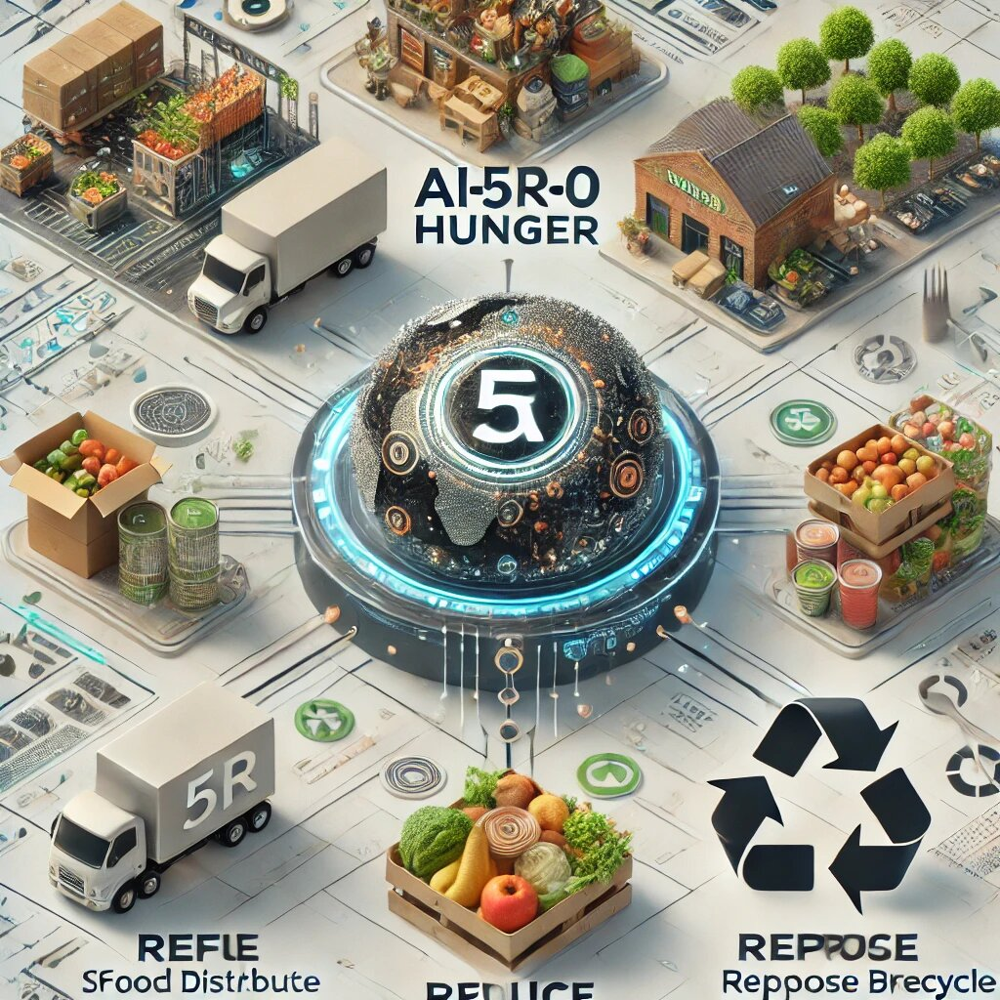
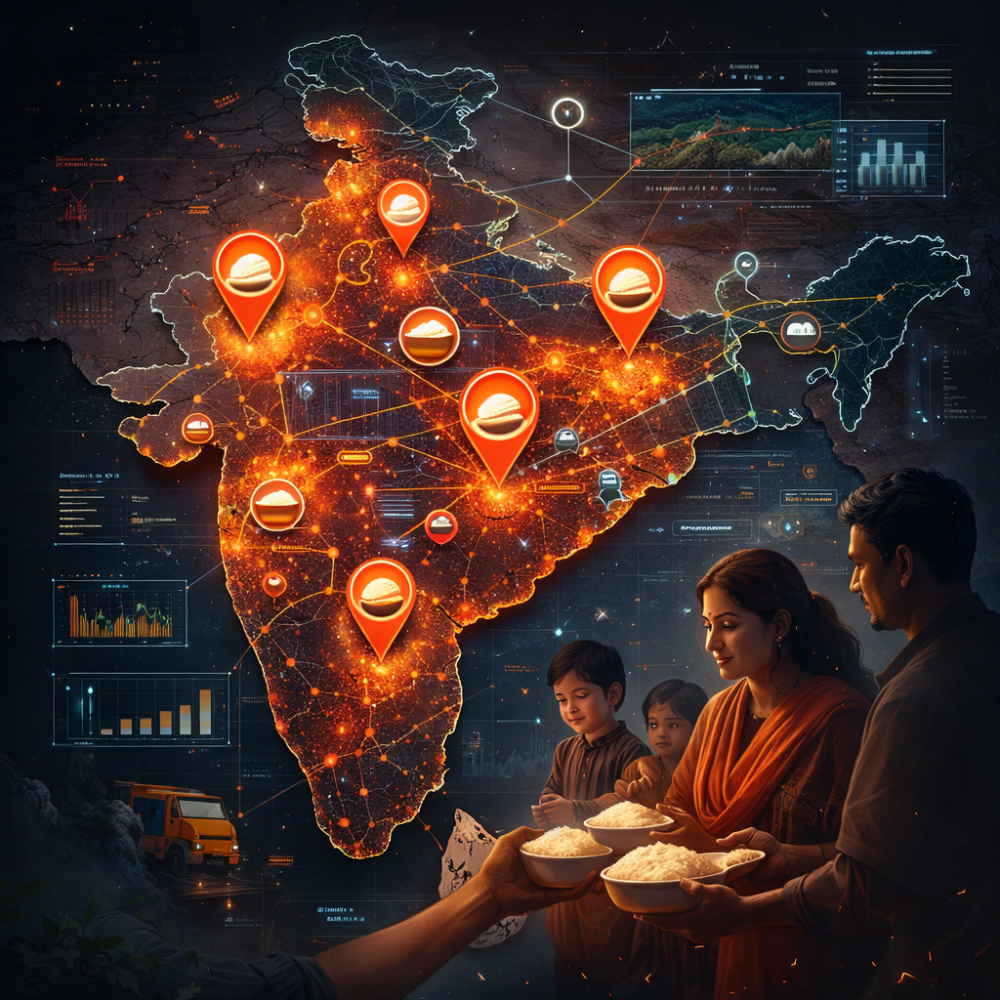
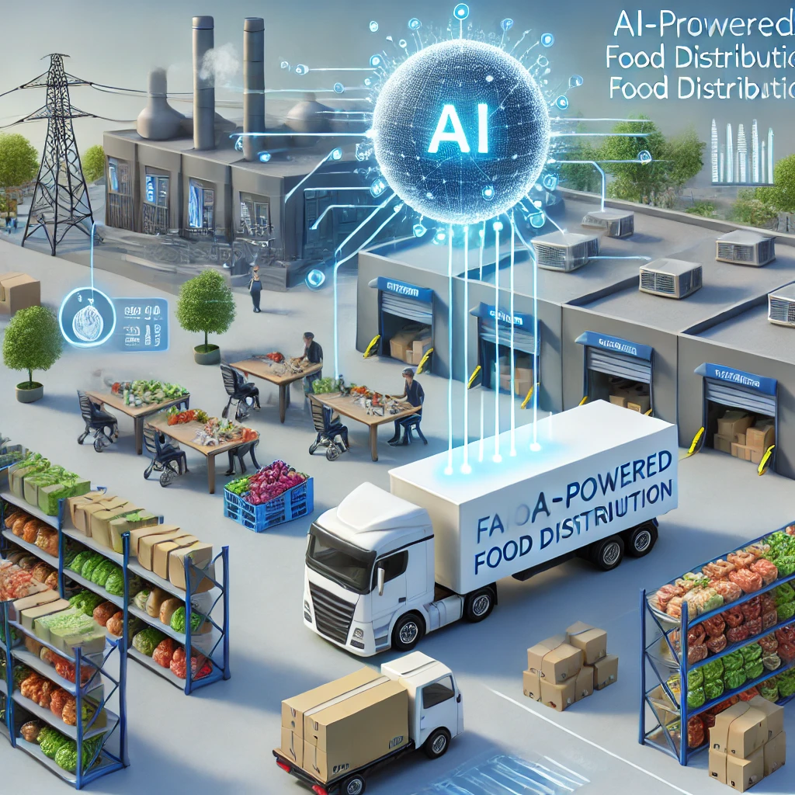

# AI5R0Hunger

> Ending hunger sustainably by combining Artificial Intelligence with the 5R Sustainability Framework.

[](https://sdgs.un.org/goals/goal2)
[](https://developer.mozilla.org/)
[](https://nodejs.org/)
[](https://www.mongodb.com/)
[](https://leafletjs.com/)

---

## 📖 Overview

**AI5R0Hunger** is a web-based platform dedicated to addressing global hunger and food waste in direct alignment with the **United Nations Sustainable Development Goal 2 (Zero Hunger)**. 

The initiative bridges two critical paradigms:
1. **Artificial Intelligence (AI)**: Applied to demand forecasting, food logistics, freshness sensing, and crop/green roof monitoring.
2. **The 5R Sustainability Framework**: Operationalizing waste reduction across five actionable stages:
   - **Refuse**: Stop unnecessary food production and packaging through predictive demand forecasting.
   - **Reduce**: Minimize supply chain bottlenecks, transport delays, and household waste.
   - **Reuse**: Channel edible restaurant/retail surplus directly to food-insecure communities.
   - **Repurpose**: Transform inedible organic waste into compost, animal feed, and alternative resources.
   - **Recycle**: Return nutrients to the soil and reuse sustainable materials in urban farming.

---

## ✨ Key Features

- **AI-Powered Surplus Food Distribution**: Smart logistics algorithms redirect edible surplus food from businesses to areas facing immediate food scarcity.
- **Smart Agriculture & Green Roof Monitoring**: Real-time environmental tracking (plant health, soil moisture, and weather forecasting) for urban rooftop gardens.
- **Interactive Hunger-Affected Geospatial Map**: Integrated Leaflet.js map with OpenStreetMap tiles displaying acute crisis zones (Chad, South Sudan, Yemen, Somalia, Madagascar).
- **Supply Chain Transparency via Blockchain**: Conceptual framework for immutable food tracking, ensuring safety and accountability.
- **Alternative & Emergency Food Initiatives**:
  - *Fireless Cooking*: Heat-retention cooking that minimizes energy consumption.
  - *Instant Meal Packets*: Quick-prep shelf-stable emergency nutrition.
  - *Restaurant Surplus Rescue*: Partnering with eateries to prevent food waste.
- **User Authentication**: Express and MongoDB/Mongoose backend supporting user registration (`/signup`) with accompanying login and sign-up interfaces.

---

## 💻 Tech Stack

- **Frontend**: HTML5, CSS3 (Flexbox, custom color palettes, responsive media queries), JavaScript (ES6+)
- **Mapping & GIS**: [Leaflet.js v1.7.1](https://leafletjs.com/) & [OpenStreetMap](https://www.openstreetmap.org/)
- **Backend API**: [Node.js](https://nodejs.org/) with [Express.js](https://expressjs.com/)
- **Database**: [MongoDB](https://www.mongodb.com/) via [Mongoose ODM](https://mongoosejs.com/)
- **Middleware**: `cors`, `body-parser`
- **Presentation**: Microsoft PowerPoint pitch deck (`.pptx`)

---

## 📂 Project Directory Structure

```text
AI5R0Hunger/
│
├── assets/
│   └── images/
│       ├── backgrounds/
│       │   └── hero-bg.jpg                           # Hero banner background
│       ├── logos/
│       │   └── logo.jpg                              # Official AI5R0Hunger circular logo
│       ├── content/
│       │   ├── ai-assistant.jpg                      # Community AI assistant illustration
│       │   ├── ai-greenroof.jpg                      # Green roof IoT monitoring sensor visual
│       │   ├── ai5r0hunger-about.jpg                 # About Us feature banner
│       │   ├── blockchain-tracking.jpg               # Blockchain food tracking illustration
│       │   ├── fireless-cooking.jpg                  # Fireless cooking initiative visual
│       │   ├── food-dis.jpg                          # Food distribution logistics graphic
│       │   ├── food-distribution.jpg                 # Distribution workflow step
│       │   ├── food-quality.jpg                      # Food quality & safety sensor visual
│       │   ├── instant-meal-packets.jpg              # Emergency meal packets
│       │   ├── join.jpg                              # Community movement banner
│       │   ├── location.png                          # Geographic hotspot focus graphic
│       │   ├── our-mission.jpg                       # Mission statement feature graphic
│       │   ├── real-time-analytics.jpg               # Data analytics workflow step
│       │   ├── restaurant-surplus.png                # Restaurant food rescue initiative
│       │   ├── smart-agriculture.jpg                 # Urban farming & green roofs
│       │   ├── smart-farming.jpg                     # Precision agriculture graphic
│       │   ├── solutions.jpg                         # Solutions overview banner
│       │   ├── waste-to-food.jpg                     # Waste conversion graphic
│       │   └── works.jpg                             # How It Works banner
│       └── unused/
│           ├── dalle-ai-wheat-logo.webp              # Unused AI-generated concept logo
│           ├── fireless-cooking-duplicate.jpg        # Unused duplicate asset
│           └── green-roof.jpg                        # Unused stock photo
│
├── 0hunger.html                                      # Home / Landing page
├── About Us.html                                     # Detailed 5R sustainability & mission
├── How It Works.html                                 # 5-step operational workflow
├── Hunger-Affected.html                              # Leaflet interactive crisis map
├── Our Mission.html                                  # Core mission & vision
├── Solutions.html                                    # 8 sustainable food security solutions
├── log.html                                          # User login interface
├── sign.html                                         # User registration interface
│
├── server.js                                         # Express & MongoDB backend API
├── .env.example                                      # Environment variable template
├── .gitignore                                        # Git ignore rules
│
├── AI5R0Hunger-Ending-Hunger-Sustainably-with-Artificial-Intelligence (1).pptx  # Pitch deck
└── README.md                                         # Project documentation
```

---

## ⚙️ Prerequisites

- **Web Browser**: Google Chrome, Mozilla Firefox, Microsoft Edge, or Safari.
- **Node.js**: v14.0.0 or higher ([Download Node.js](https://nodejs.org/)).
- **MongoDB**: Local MongoDB Community Server running on port `27017` or MongoDB Atlas URI ([Download MongoDB](https://www.mongodb.com/try/download/community)).

---

## 🚀 Installation & Setup

### 1. Clone or Open the Repository
```bash
git clone <repository-url>
cd AI5R0Hunger
```

### 2. Frontend Setup
The frontend uses standard HTML5/CSS/JavaScript with CDN-hosted Leaflet libraries. No compilation or build step is required:
- Open [`0hunger.html`](0hunger.html) directly in any web browser, or
- Serve using any static HTTP server:
  ```bash
  npx serve .
  ```

### 3. Backend Setup
1. Initialize dependencies:
   ```bash
   npm init -y
   npm install express mongoose cors body-parser
   ```
2. Ensure MongoDB is running on your machine:
   ```bash
   mongod
   ```
3. Start the backend server:
   ```bash
   node server.js
   ```
4. The server runs at:
   ```text
   http://localhost:3000
   ```

---

## 🔐 Environment Variables

The project connects to MongoDB and runs on port 3000 by default in `server.js`. For production deployments, configure these variable names in a `.env` file (refer to `.env.example`):

- `PORT` - Port number for the Express server (e.g., `3000`).
- `MONGODB_URI` - MongoDB connection string (e.g., `mongodb://localhost:27017/ai5r0hunger`).

---

## 📸 Screenshots & Usage

| Section | Preview | Description |
| :--- | :--- | :--- |
| **Landing & Navigation** |  | Comprehensive overview of the AI5R0Hunger initiative and core principles. |
| **5R Sustainability** |  | Explains Refuse, Reduce, Reuse, Repurpose, and Recycle in the food ecosystem. |
| **Smart Agriculture** |  | IoT & AI-guided rooftop cultivation and monitoring. |
| **Crisis Mapping** |  | Interactive Leaflet.js map tracking areas experiencing acute hunger crises. |
| **Food Distribution** |  | Intelligent surplus allocation to food banks and local communities. |

---

## 🔮 Future Improvements

- [ ] Connect `sign.html` and `log.html` forms directly to `server.js` with client-side `fetch()` handlers.
- [ ] Implement JWT (JSON Web Token) authentication and bcrypt password hashing.
- [ ] Connect `Hunger-Affected.html` to live humanitarian food crisis APIs (e.g., WFP or FAO data feeds).
- [ ] Modernize internal page links in `0hunger.html` to relative URL navigation.
- [ ] Expand the AI Green Roof alerting system with simulated IoT sensor webhooks.

---

## 📜 License

This project is open-source and available under the **MIT License**.

---

## 👤 Author

**Siddharth**  
Project: **AI5R0Hunger**  
Ending Hunger Sustainably with Artificial Intelligence
